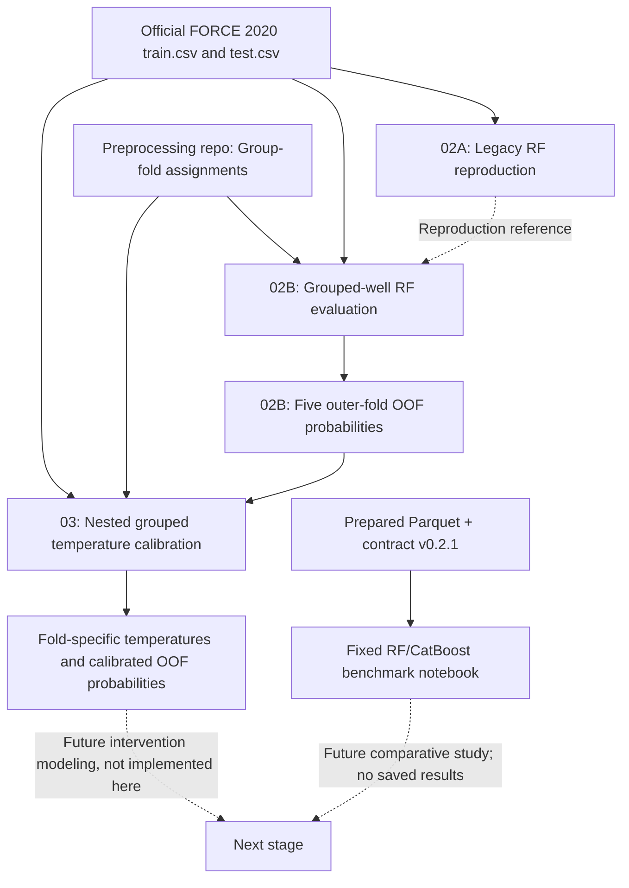

# FORCE 2020: Lithology Benchmarks and Nested Probability Calibration

**Legacy Random Forest reproduction · Well-grouped validation · Nested temperature calibration · RF/CatBoost benchmarks**

> **Scope:** Reproducible research code for lithology classification on FORCE 2020 well logs. This repository covers model reproduction, evaluation and probability calibration; it does **not** estimate causal treatment effects or claim that well-log measurements cause geological formations.

## Overview

The FORCE 2020 well-log dataset contains multi-well measurements and lithology labels. Because consecutive depth samples within a well are correlated, random row-level validation can give an optimistic impression of generalization. This repository addresses four related questions:

1. **Can a prior, legacy Random Forest workflow be reproduced as implemented?**
2. **How does the same workflow perform when validation wells are never used to train that fold's model?**
3. **Can the out-of-fold Random Forest class probabilities be calibrated without using the held-out well group directly or indirectly during temperature fitting?**
4. **How can Random Forest and CatBoost benchmarks be compared across feature sets with grouped validation?**

The distinction between *faithful reproduction* and *methodological improvement* is intentional. The legacy reproduction retains historical implementation choices, including questionable ones, to make the comparison interpretable.

## Repository contents

| Notebook | Purpose | Execution status in uploaded source |
|---|---|---|
| [`02A_FORCE_legacy_RF_exact_reproduction.ipynb`](notebooks/02A_FORCE_legacy_RF_exact_reproduction.ipynb) | Reproduce the legacy 800-tree RF pipeline on official train/test files, including its original feature engineering, resampling and post-processing | **Saved full-run outputs present**; the built-in reproduction gate passed |
| [`02B_FORCE_legacy_RF_grouped_well_CV.ipynb`](notebooks/02B_FORCE_legacy_RF_grouped_well_CV.ipynb) | Evaluate the **same legacy RF** with five held-out groups of wells; compare pooled out-of-fold (OOF) predictions | **Saved five-fold full-run outputs present** |
| [`03_FORCE_nested_grouped_temperature_calibration_CORRECTED.ipynb`](notebooks/03_FORCE_nested_grouped_temperature_calibration_CORRECTED.ipynb) | Use 02B out-of-fold Random Forest probabilities, fit fold-specific temperatures with nested held-out fold pairs, and compare probability reliability | **Saved full-run outputs present**, including pooled calibration metrics and a passing internal gate |
| [`02_FORCE_RF_primary_CatBoost_grouped_cv_FIXED.ipynb`](notebooks/02_FORCE_RF_primary_CatBoost_grouped_cv_FIXED.ipynb) | Provide RF/CatBoost benchmarks over several feature designs, with a class-safe inner validation split for CatBoost | **Code provided; no saved model-run results in the supplied notebook**; default `RUN_MODE = "pilot"` |

The earlier non-`FIXED` RF/CatBoost notebook has been **deliberately excluded** to avoid two competing versions of the same benchmark. The unrelated GEOLINK LAS audit is outside the scope of this repository.

### Workflow



## 1. Exact legacy RF reproduction — Notebook 02A

This notebook loads the official FORCE 2020 train and test CSVs, verifies that their well identifiers do not overlap, recreates the **800-tree Random Forest** configuration and the **26-position legacy feature list**, and reproduces the preprocessing and hybrid resampling used in the earlier implementation. It then computes predictions and class probabilities on the labeled official test split and reports performance both **before** and **after** a legacy Chalk-specific label-refinement rule.

The code intentionally preserves certain historical behaviors for fidelity:

- `X_LOC` occurs more than once in the legacy feature list.
- The legacy oversampling procedure includes a known Basement/Dolomite inconsistency.
- Test depth normalization uses the test set's own depth range.
- Some historical gradients were constructed without a `WELL` boundary.
- The label-refinement rule can change a prediction to Chalk when Chalk has the second-largest predicted probability.

These behaviors **must not** be interpreted as recommended modeling practice. The refined labels are a post-processing output; they are not newly calibrated class probabilities. The notebook includes a tolerance-based gate against expected legacy accuracies.

### Results recorded in the original notebook

| Protocol | Prediction variant | Accuracy | Macro-F1 |
|---|---|---:|---:|
| Official labeled test (10 wells) | RF raw | **0.797944** | **0.532425** |
| Official labeled test (10 wells) | Legacy Chalk-refined labels | **0.807765** | **0.578539** |

The source notebook's reproduction gate reports `overall_reproduction_passed = true`, with 0.5-percentage-point accuracy tolerance. This means its accuracy targets were met **within the configured tolerance**; it is not a guarantee of exact, bit-for-bit numerical reproduction across software versions or machines.

## 2. Well-grouped legacy RF validation — Notebook 02B

This notebook reuses the legacy RF hyperparameters and feature design but changes the **evaluation protocol** to five folds defined by groups of wells. Each validation fold comprises wells absent from that fold's training set. The notebook loads `train.csv` and prior-stage well-fold assignments; it does not use official `test.csv` for fold training/evaluation. For each fold, it generates raw probabilities, raw labels, legacy Chalk-refined labels, fold-level/class-level/well-level metrics, feature importance, and resampling audits. Completed runs can be skipped based on saved artifacts.

The notebook preserves the legacy algorithm rather than silently repairing its historical design choices. Group separation alone does not make all preprocessing choices methodologically optimal. Note also that **macro-F1 for classes present in a validation fold** and **macro-F1 over all 12 classes** are distinct reporting conventions.

### Results recorded in the original notebook

| Protocol | Prediction variant | Accuracy | Macro-F1 (pooled OOF) |
|---|---|---:|---:|
| Five-fold grouped-well OOF | RF raw | **0.724459** | **0.342907** |
| Five-fold grouped-well OOF | Legacy Chalk-refined labels | **0.723001** | **0.367302** |

These OOF results come from a **different evaluation population and protocol** than the official test results in 02A. The difference should not be attributed exclusively to leakage without further controlled study. Notably, the Chalk rule slightly reduced grouped-OOF accuracy while improving the reported pooled macro-F1.

## 3. Nested grouped temperature calibration — Notebook 03 (corrected)

**Purpose.** Use the *raw* class-probability vectors from the five held-out-well RF evaluation folds produced by **02B** and improve probability calibration without retraining the final outer-fold models. This is **not** a new lithology classifier and does **not** use the legacy Chalk-adjusted labels when fitting temperatures. A prior, less strictly nested calibration design is intentionally excluded.

### Leakage-aware nested procedure

For each target outer fold $k$, calibration targets are constructed from the **other four folds**. To predict an inner validation fold $j \neq k$, a new 800-tree RF is trained on the **three folds excluding both $k$ and $j$**; that model predicts only held-out $j$. This ensures that the outer target fold neither supplies calibration labels nor appears in training data for models generating calibration probabilities. For five outer folds, pair-caching unordered held-out pairs requires $\binom{5}{2}=10$ distinct RF training runs, each predicting both held-out folds. A full run reuses valid pair caches from a pilot run.

The calibration transformation uses positive temperature $T$ and original probabilities $p_c$:

$$
\widetilde{p}_c(T) = \frac{\exp(\log(\max(p_c,\varepsilon))/T)}{\sum_r \exp(\log(\max(p_r,\varepsilon))/T)}.
$$

The fold-specific temperature is selected by **minimizing multiclass log loss on its nested inner OOF predictions**, with \(T\in[0.05,10]\). Its value is then applied to the original **02B** probabilities for that held-out outer fold. The predictions are evaluated by Accuracy, multiclass Log Loss, summed-class Brier Score, and **15-bin top-label Expected Calibration Error (ECE)**. A reliability diagram, pooled and per-fold summaries, temperature registries, and a gate report are produced.

### Results recorded in the corrected notebook

| Pooled metric | Raw 02B RF OOF probabilities | Nested calibrated probabilities | Interpretation |
|---|---:|---:|---|
| Accuracy | 0.724459 | 0.724459 | Unchanged |
| Multiclass Log Loss ↓ | 0.837567 | **0.815921** | Improved |
| Multiclass Brier Score ↓ | 0.397257 | **0.388055** | Improved |
| ECE (15 bins) ↓ | 0.079152 | **0.025561** | Improved |
| Mean maximum-class confidence | 0.645311 | 0.709664 | Higher after calibration |

The recorded `overall_nested_calibration_passed` gate is `true`. These figures are **saved historical full-run outputs**, not results newly recomputed for this public-release package. The recorded execution reused previously completed pair caches for some pairs; the release contains no trained RF models or pair-cache data.

**Important qualifications:** (i) the outer probabilities themselves must come from the correctly implemented 02B well-grouped protocol; (ii) pair-cache provenance must be verified before reuse; (iii) ECE is bin-dependent, and pooled confidence calibration does not guarantee equal calibration across wells or lithology classes; (iv) calibration improvements do not establish causal effects.

**Required inputs** in addition to raw `train.csv`:
- `data/prepared/10_grouped_5fold_well_assignment.csv` (from the preprocessing-stage repository);
- all five `outputs/02B_legacy_RF_grouped_well_CV/full/oof_predictions/legacy_exact__outer_fold_<k>__oof.parquet` files from **02B full mode**;
- optionally `outputs/02B_legacy_RF_grouped_well_CV/full/12_run_configuration.json`, which is checked when present.

**Run modes:** `RUN_MODE = "pilot"` calibrates the first outer fold and needs four held-out-pair RF fits; `RUN_MODE = "full"` covers all five outer folds, requiring up to ten pair models. The notebook as provided has `RUN_MODE = "full"`; switch it to `"pilot"` first if testing. The pair caches, calibrated probabilities, reliability plots, and calibration summaries are saved under `outputs/03_nested_grouped_temperature_calibration/` and excluded from Git.

## 4. RF and CatBoost benchmarks — Fixed notebook

This notebook reads the prepared training Parquet and a prerequisite **baseline-ready causal contract v0.2.1**, then trains or configures grouped-well comparisons for **Random Forest** and **CatBoost** with the following feature-set designs:

| ID | Features | Evaluation purpose |
|---|---|---|
| **B0** | Depth, spatial and stratigraphic context | Context-only shortcut diagnostic |
| **B1** | Primary well-log measurements | Direct measurement baseline |
| **B2** | Primary logs, pathway-driver variables and domain-engineered features | Domain-guided modeling |
| **B3** | Broad physical logs and stratigraphic context, excluding explicit XYZ coordinates | Evaluate non-spatial predictors |
| **B4** | Full contextual/spatial feature set | Detect potential spatial shortcut dependence |

**Default pilot:** one outer fold, `B1`/`B2` for RF and CatBoost, up to 2,500 rows per well, 120 RF trees and 180 maximum CatBoost iterations.

**Full mode:** five outer folds; RF on B0–B4 (800 trees); CatBoost on B1, B2 and B4 (up to 700 iterations). CatBoost includes early stopping and a well-grouped inner validation design. In the **FIXED** version, the inner split is checked to ensure no validation-only class is absent from the inner-training data, and the prediction Pool is handled without test labels.

The implementation saves fold metrics, OOF predictions, per-well/per-class statistics, feature importances, plots and run metadata **when executed**. The uploaded FIXED notebook contains no saved execution results, so this repository **does not claim demonstrated RF-versus-CatBoost superiority**.

## Key scientific distinction

- **02A** asks *was the former implementation reproduced?* and uses the official labeled test.
- **02B** asks *how does the same former implementation perform on held-out wells?* and uses five-fold grouped OOF predictions from training wells.
- **03 corrected nested calibration** asks *are RF probability estimates more trustworthy after temperature scaling while respecting held-out-well separation?* It calibrates **02B raw probability vectors**, not post-processed labels.
- **Fixed RF/CatBoost** asks *how do alternative models and feature sets compare under the shared grouped protocol?* Its results require execution.

Different datasets, class representation, class weighting, training budgets and evaluation protocols matter when interpreting these comparisons. Avoid presenting one test-set number and one OOF number as if they were paired measurements under identical conditions.

## Local setup: data and dependencies

**Raw and derived datasets are intentionally not committed.** You need to download the FORCE 2020 data from its permitted source and generate the prepared artifacts in the companion preprocessing workflow before running all four notebooks.

Expected local directory structure:

```text
FORCE2020-Lithology-Benchmarks-and-Calibration/
├── README.md
├── requirements.txt
├── .gitignore
├── notebooks/
│   ├── 02A_FORCE_legacy_RF_exact_reproduction.ipynb
│   ├── 02B_FORCE_legacy_RF_grouped_well_CV.ipynb
│   ├── 02_FORCE_RF_primary_CatBoost_grouped_cv_FIXED.ipynb
│   └── 03_FORCE_nested_grouped_temperature_calibration_CORRECTED.ipynb
├── data/
│   ├── raw/                  # ignored by git
│   │   ├── train.csv
│   │   └── test.csv
│   └── prepared/             # ignored by git
│       ├── 10_grouped_5fold_well_assignment.csv
│       ├── FORCE_train_cleaned_with_splits.parquet
│       └── 07_causal_project_contract_v0_2_1.json
├── outputs/                  # ignored by git; created automatically
└── scripts/
    └── check_release.py
```

**Note on data provenance:** `10_grouped_5fold_well_assignment.csv` and `FORCE_train_cleaned_with_splits.parquet` are outputs of the earlier `01_FORCE_clean_group_spatial_support_splits` workflow; the `07_causal_project_contract_v0_2_1.json` is created by `01B_FORCE_fix_local_windows_and_lock_contract`. This repository does not include their source notebooks; they belong in the separate `FORCE2020-Intervention-Readiness` data-preparation repository. Add the exact GitHub URL here after confirming the account and repository name.

### Install and run

From the project root:

```bash
python3 -m venv .venv
source .venv/bin/activate                # macOS / Linux
python -m pip install -r requirements.txt
python -m jupyter lab
```

On Windows, activate with `.venv\Scripts\activate`. Keep dataset files local and **do not add them to git**.

**Suggested order:**

1. **02A** — requires `data/raw/train.csv` and `data/raw/test.csv`; this creates the local legacy reproduction gate that 02B can reference.
2. **02B** — requires `data/raw/train.csv` and **either** the fold-assignment CSV **or** the prepared Parquet with `WELL` and `GROUP_FOLD`; start with `RUN_MODE="pilot"` if desired, then `"full"`.
3. **03 corrected nested calibration** — requires the original `train.csv`, the grouped-well assignment CSV, and the **02B full-mode five-fold OOF probability files**. It fits temperatures for the existing 02B raw outer predictions, not Chalk-refined labels. For a test run, change `RUN_MODE` to `"pilot"`; default in the released notebook is `"full"`.
4. **Fixed RF/CatBoost** — requires the prepared Parquet with `ROW_ID`, `WELL`, `DEPTH_MD`, `target`, `GROUP_FOLD`, `GEO_BLOCK`, plus the contract v0.2.1 with `baseline_ready: true` and the expected feature-role definitions. The default `RUN_MODE="pilot"` is **not** the complete benchmark.

The notebooks use relative project paths. Launch Jupyter from the repository root or its `notebooks/` directory. For custom locations, set environment variables **before** starting Jupyter:

| Environment variable | Default | Purpose |
|---|---|---|
| `FORCE_REPO_ROOT` | current working directory (or parent of `notebooks/`) | Repository path |
| `FORCE_DATA_DIR` | `<repo>/data/raw` | `train.csv` and `test.csv` |
| `FORCE_PREPARED_DIR` | `<repo>/data/prepared` | Fold assignment, prepared Parquet and contract |
| `FORCE_RESULTS_DIR` | `<repo>/outputs` | Local generated predictions, models and reports |

**03 also uses the same `FORCE_RESULTS_DIR`, looking for 02B full-mode OOF Parquet files under `outputs/02B_legacy_RF_grouped_well_CV/full/oof_predictions/`.** The full-mode outputs must be produced before executing 03. Both 02A and 02B use the same `FORCE_RESULTS_DIR`, allowing 02B to locate the gate from 02A in `02A_legacy_RF_exact_reproduction/09_reproduction_gate.json` when present. Existing saved notebook outputs refer to **historical runs**; their displayed paths have been redacted, and moving files does not re-run experiments.

### Verify the public-release package

```bash
python3 scripts/check_release.py
```

The script checks notebook presence/format, portable path code and accidental personal path strings. Review the staged upload as well:

```bash
git status
git diff --cached --name-only
```

Do not stage raw CSVs, full prediction tables, trained model weights, private credentials or other large generated files. Unlike raw data and generated artifacts, **saved notebook cell outputs are retained** for transparency in the three executed notebooks (02A, 02B and 03).

## Results, reproducibility and limitations

- **02A, 02B and corrected 03** contain saved numerical results. Those results were **not re-computed** as part of preparing this public-release package. The RF/CatBoost notebook has no saved results.
- Temperature scaling leaves the most-likely class unchanged for strictly positive temperatures, but changes probability magnitudes. Improvements in probability scoring rules and top-label ECE should not be mistaken for increased classification accuracy.
- In the corrected 03 notebook, the internal gate checks certain numerical criteria; its `outer_target_excluded_directly_and_indirectly` field is set by the program, while the fold-exclusion validations appear in code. This is not an external certification of full-pipeline leakage freedom.
- The third notebook is an available benchmark **implementation**, not a demonstrated completed evaluation.
- The legacy workflow intentionally preserves possible methodological shortcomings. Use the newer grouped design for investigating generalization, but do not assume it automatically fixes all old feature-engineering issues.
- Fold-based metrics and official test metrics are not directly interchangeable. Rare classes may be absent from an individual validation fold; class-wise metrics and support counts must be interpreted accordingly.
- Even though an earlier preprocessing project defines intervention-support contracts, **no ATE/CATE estimation or causal identification result is claimed here**.
- Software dependency ranges are provided for convenience; an original environment lockfile was not present, so exact byte-for-byte reproducibility across machines is not guaranteed.
- Model training may consume substantial CPU time, memory and disk space, especially 800-tree RF models and probability outputs.
- If publishing results externally, provide the appropriate reference for the *prior Random Forest paper/implementation*; the uploaded notebooks do not provide enough bibliographic detail here to invent that citation.

## Dataset credit and licensing

The FORCE 2020 lithology competition describes the **well-log data under NLOD 2.0** and the **provided labels under CC BY 4.0**. See the [official competition rules](https://thinkonward.com/app/c/challenges/force-well-logs/rules) and respect applicable attribution conditions. No FORCE dataset rows are redistributed in this repository; it contains code and retained compact notebook outputs only. Before selecting a software license for this code, ensure all contributors have agreed to publication and licensing.

## Citation and acknowledgments

If you use this repository in scientific work, cite the corresponding FORCE 2020 dataset and the earlier Random Forest approach being reproduced; substitute the **verified bibliographic entries** before submitting a manuscript. If this becomes a citable software release, you can archive a numbered version via Zenodo and add a `CITATION.cff` file.

---

**Research status:** legacy reproduction gate passed within defined tolerances · five-fold grouped RF OOF results available · corrected nested calibration completed in saved full-run outputs · fixed RF/CatBoost benchmark implementation available, with results awaiting execution.
