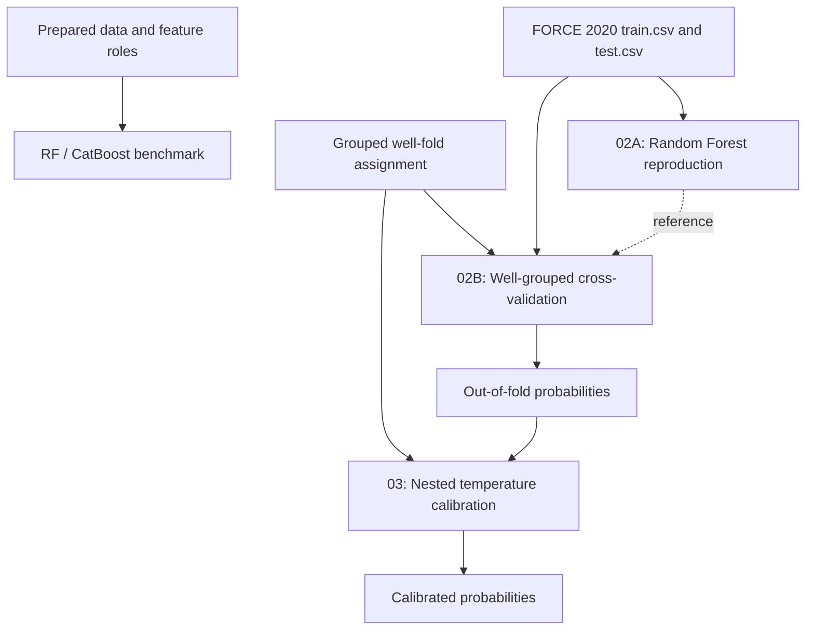

# FORCE 2020: Lithology Benchmarks and Nested Probability Calibration

**Random Forest reproduction · Well-grouped validation · Nested temperature calibration · RF/CatBoost benchmarks**

Research code for **lithology classification from well logs** on the FORCE 2020 dataset, covering model reproduction, leakage-aware evaluation, and probability calibration.

## Overview

The FORCE 2020 dataset contains well-log measurements and lithology labels from many wells. Because neighboring depth samples within a well are highly correlated, random row-level validation tends to overestimate how well a model generalizes to new wells. This repository addresses four questions:

1. Can a reference Random Forest lithology pipeline be faithfully reproduced?
2. How does that pipeline perform when evaluated on **wells it has never seen**?
3. Can its class probabilities be calibrated **without leaking information** from the evaluated wells?
4. How do Random Forest and CatBoost compare across different feature sets under grouped validation?

## Notebooks

| Notebook | Purpose |
|---|---|
| [`02A_FORCE_legacy_RF_exact_reproduction.ipynb`](notebooks/02A_FORCE_legacy_RF_exact_reproduction.ipynb) | Reproduces the reference 800-tree Random Forest pipeline on the official train and test sets |
| [`02B_FORCE_legacy_RF_grouped_well_CV.ipynb`](notebooks/02B_FORCE_legacy_RF_grouped_well_CV.ipynb) | Evaluates the same model with five-fold well-grouped cross-validation |
| [`03_FORCE_nested_grouped_temperature_calibration_CORRECTED.ipynb`](notebooks/03_FORCE_nested_grouped_temperature_calibration_CORRECTED.ipynb) | Calibrates the out-of-fold probabilities with nested, well-grouped temperature scaling |
| [`02_FORCE_RF_primary_CatBoost_grouped_cv_FIXED.ipynb`](notebooks/02_FORCE_RF_primary_CatBoost_grouped_cv_FIXED.ipynb) | Benchmark framework for Random Forest and CatBoost across five feature-set designs |

### Workflow



## 1. Random Forest reproduction (02A)

Rebuilds the reference pipeline end to end: an **800-tree Random Forest** with its original 26-feature design, preprocessing, resampling, and a Chalk-specific post-processing rule. The notebook checks that train and test wells do not overlap and includes an automated reproduction check against the expected accuracy.

| Evaluation | Variant | Accuracy | Macro-F1 |
|---|---|---:|---:|
| Official test set (10 wells) | Random Forest | 0.798 | 0.532 |
| Official test set (10 wells) | With Chalk refinement | **0.808** | **0.579** |

The reproduction check passed within the defined tolerance.

## 2. Well-grouped cross-validation (02B)

Keeps the same model and features but changes the **evaluation protocol** to five folds built from groups of wells, so every validation fold contains only wells unseen during training. For each fold it reports probabilities, predictions, fold-, class-, and well-level metrics, and feature importance.

| Evaluation | Variant | Accuracy | Macro-F1 |
|---|---|---:|---:|
| Five-fold grouped CV | Random Forest | 0.724 | 0.343 |
| Five-fold grouped CV | With Chalk refinement | 0.723 | 0.367 |

Grouped validation provides a more **realistic estimate of performance on new wells** and serves as the evaluation basis for the calibration stage and the companion projects.

## 3. Nested temperature calibration (03)

Improves the reliability of the Random Forest's class probabilities from 02B without retraining the evaluated models.

**Leakage-free nested design.** For each outer fold *k*, calibration data are built from the other four folds. To predict an inner fold *j*, a new Random Forest is trained on the three folds that exclude both *k* and *j*. As a result, the evaluated fold never contributes to calibration, either directly or indirectly. Ten pairwise models cover all five folds.

The calibrated probabilities use a positive temperature $T$:

$$
\widetilde{p}_c(T) = \frac{\exp(\log(\max(p_c,\varepsilon))/T)}{\sum_r \exp(\log(\max(p_r,\varepsilon))/T)}
$$

Each fold's temperature minimizes multiclass log loss on its nested inner predictions ($T \in [0.05, 10]$).

| Metric | Before calibration | After calibration |
|---|---:|---:|
| Accuracy | 0.724 | 0.724 |
| Log loss ↓ | 0.838 | **0.816** |
| Brier score ↓ | 0.397 | **0.388** |
| ECE (15 bins) ↓ | 0.079 | **0.026** |

Calibration improved **all three probability metrics** and reduced the expected calibration error by about two thirds, while keeping predicted labels and accuracy unchanged. The notebook also produces reliability diagrams and per-fold summaries.

## 4. RF and CatBoost benchmark framework

Compares **Random Forest** and **CatBoost** under the same grouped protocol across five feature-set designs:

| ID | Features | Purpose |
|---|---|---|
| **B0** | Depth, spatial, and stratigraphic context | Context-only baseline |
| **B1** | Primary well logs | Direct measurement baseline |
| **B2** | Primary logs plus domain-engineered features | Domain-guided modeling |
| **B3** | Physical logs and stratigraphic context, without coordinates | Non-spatial predictors |
| **B4** | Full contextual and spatial feature set | Effect of spatial information |

CatBoost uses early stopping with a well-grouped inner validation split that guarantees every class is represented in inner training. The notebook supports a quick **pilot mode** (one fold, B1/B2) and a **full mode** (five folds, all feature sets), and saves fold metrics, out-of-fold predictions, per-well and per-class statistics, and feature importances.

## Summary of the studies

- **02A** reproduces the reference pipeline on the official test set.
- **02B** measures how the same pipeline generalizes to unseen wells.
- **03** makes the model's probabilities more reliable with leakage-free calibration.
- **RF/CatBoost** compares models and feature sets under one shared grouped protocol.

## Getting started

### Directory structure

```text
FORCE2020-Lithology-Benchmarks-and-Calibration/
├── README.md
├── requirements.txt
├── .gitignore
├── notebooks/
│   ├── 02A_FORCE_legacy_RF_exact_reproduction.ipynb
│   ├── 02B_FORCE_legacy_RF_grouped_well_CV.ipynb
│   ├── 02_FORCE_RF_primary_CatBoost_grouped_cv_FIXED.ipynb
│   └── 03_FORCE_nested_grouped_temperature_calibration_CORRECTED.ipynb
├── data/
│   ├── raw/                  # train.csv, test.csv
│   └── prepared/             # fold assignment, prepared Parquet, feature contract
├── outputs/                  # created automatically
└── scripts/
    └── check_release.py
```

The prepared files (`10_grouped_5fold_well_assignment.csv`, `FORCE_train_cleaned_with_splits.parquet`, and `07_causal_project_contract_v0_2_1.json`) are produced by the companion data-preparation workflow.

### Installation

```bash
git clone https://github.com/Mohaddesemoghaddam/FORCE2020-Lithology-Benchmarks-and-Calibration.git
cd FORCE2020-Lithology-Benchmarks-and-Calibration
python3 -m venv .venv
source .venv/bin/activate                # Windows: .venv\Scripts\activate
python -m pip install -r requirements.txt
python -m jupyter lab
```

### Run order

1. **02A**: needs `data/raw/train.csv` and `data/raw/test.csv`.
2. **02B**: needs `train.csv` and the grouped fold assignment. Supports `RUN_MODE="pilot"` for a quick check and `"full"` for all five folds.
3. **03**: needs `train.csv`, the fold assignment, and the full-mode out-of-fold predictions from 02B.
4. **RF/CatBoost**: needs the prepared Parquet file and the feature contract. Use `RUN_MODE="full"` for the complete benchmark.

### Path configuration

Launch Jupyter from the repository root. For custom locations, set these variables before starting Jupyter:

| Variable | Default | Purpose |
|---|---|---|
| `FORCE_REPO_ROOT` | Current directory | Repository root |
| `FORCE_DATA_DIR` | `<repo>/data/raw` | `train.csv` and `test.csv` |
| `FORCE_PREPARED_DIR` | `<repo>/data/prepared` | Fold assignment, prepared data, feature contract |
| `FORCE_RESULTS_DIR` | `<repo>/outputs` | Predictions, models, and reports |

## Future work

- Run the full RF/CatBoost benchmark across all feature sets
- Extend calibration analysis to per-well and per-class reliability
- Compare temperature scaling with other calibration methods, such as vector and Dirichlet calibration

## Data and attribution

This project uses the **FORCE 2020 lithology competition dataset**, which is not redistributed here. Well logs are released under **NLOD 2.0** and labels under **CC BY 4.0**; see the [official competition rules](https://thinkonward.com/app/c/challenges/force-well-logs/rules).

> Lithofacies data was provided by the FORCE Machine Learning competition with well logs and seismic 2020.

**Related repositories:** [StrataShift](https://github.com/Mohaddesemoghaddam/StrataShift) · [StrataWeave](https://github.com/Mohaddesemoghaddam/StrataWeave)

**Author:** Mohaddese Moghaddam
